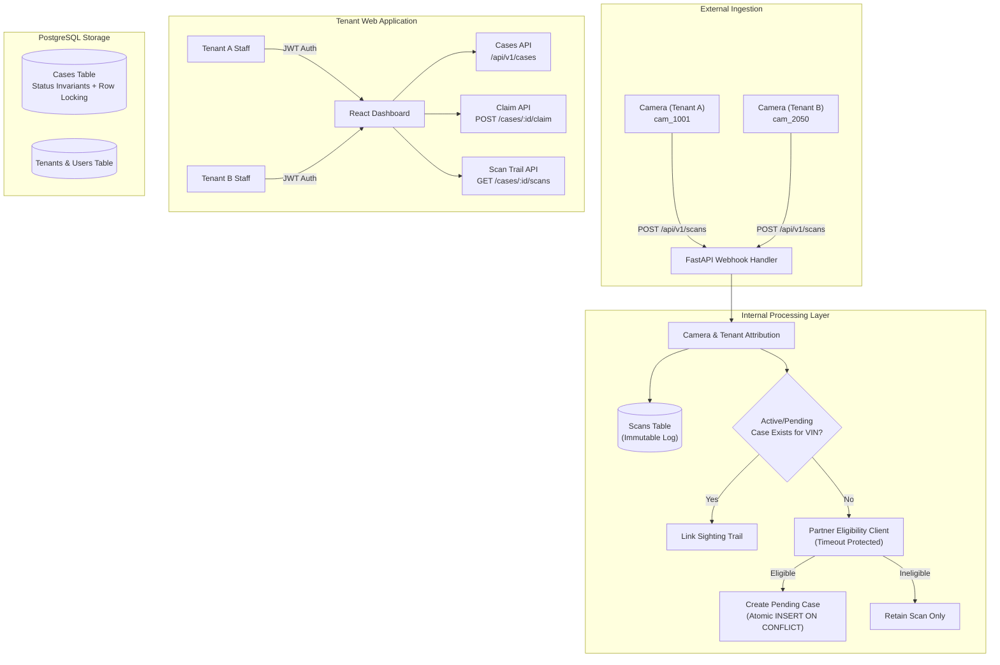
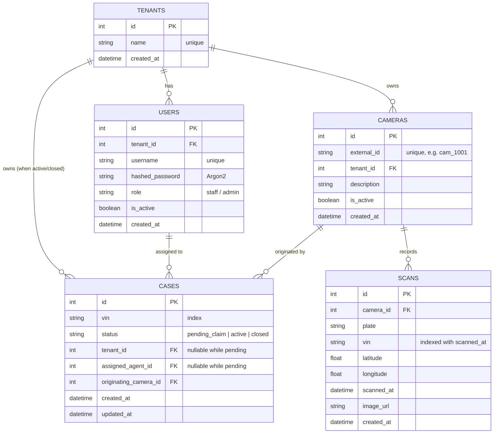
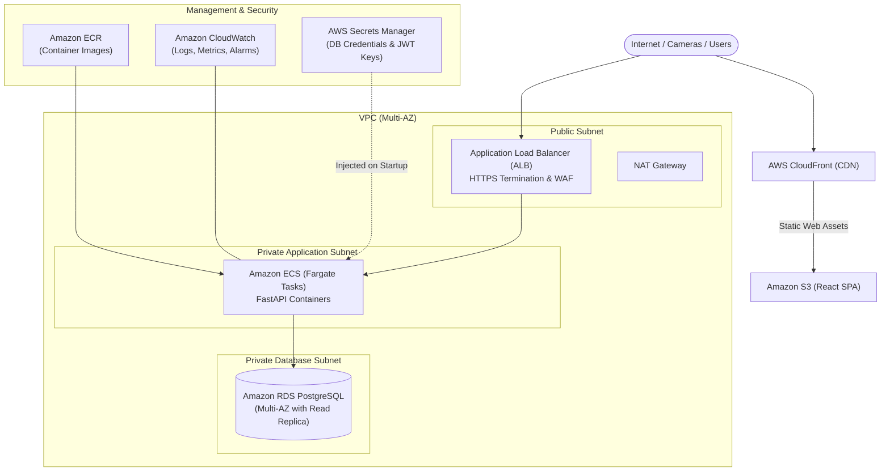

# Design Document: Plate Scan & Case Matching Service

This document describes the architectural decisions, database models, multi-tenancy safeguards, concurrency control patterns, and production deployment designs for the Plate Scan & Case Matching Service.

---

## 1. System Architecture

The Plate Scan & Case Matching Service provides high-throughput vehicle plate scan ingestion, automatic recovery case matching, cross-tenant case claiming, and historical sighting retrieval.



---

## 2. Database Schema and ER Diagram

The database uses PostgreSQL with foreign keys, check constraints, and a partial unique index ensuring that **at most one open (`pending_claim` or `active`) case exists per VIN** at any given moment, while permitting historical closed cases for repeat recovery lifecycles.



### Key Database Invariants & Constraints

1. **Partial Unique Index on Open Cases**:
   ```sql
   CREATE UNIQUE INDEX ix_cases_vin_open_unique
   ON cases (vin)
   WHERE status IN ('pending_claim', 'active');
   ```
   *Policy:* A vehicle can only have one open case (pending or active) across the entire system. When a case is `closed`, future sightings can trigger a new recovery lifecycle for that same VIN without violating uniqueness.

2. **Status and Ownership Constraints**:
   - `ck_cases_status`: `status IN ('pending_claim', 'active', 'closed')`
   - `ck_cases_pending_no_owner`: If `status = 'pending_claim'`, `tenant_id IS NULL AND assigned_agent_id IS NULL`.
   - `ck_cases_active_has_owner`: If `status = 'active'`, `tenant_id IS NOT NULL AND assigned_agent_id IS NOT NULL`.

3. **Immutable Camera Sightings**:
   - `scans` table contains raw sensor readings linked directly to `camera_id`.
   - Historical scans are never updated, deleted, or transferred when a case is claimed by a different tenant.

---

## 3. Multi-Tenancy and Access-Control Model

### Tenant Isolation Principles
- **Authoritative Server Resolution**: Tenant identity is resolved strictly from the authenticated JWT token `sub` claim. Frontend request payloads or query parameters specifying `tenant_id` are ignored and never trusted.
- **Camera Tenant Attribution**: A camera's owning tenant is determined exclusively via the database relation `cameras.tenant_id`. Webhook callers cannot spoof camera ownership.
- **Tenant Scope Enforcement**:
  - `GET /api/v1/cases`: Returns `(Case.tenant_id == current_user.tenant_id) OR (Case.status == 'pending_claim')`. Active and closed cases belonging to other tenants are strictly filtered out at the SQL query level.
  - `GET /api/v1/cases/{case_id}/scans`: Verifies that the case either has `status == 'pending_claim'` or `case.tenant_id == current_user.tenant_id`. If unauthorized, a **404 Not Found** is returned to avoid revealing the existence of other tenants' cases.
  - `POST /api/v1/cases/{case_id}/claim`: Represents the intentional cross-tenant exception: any authenticated user may claim an unassigned pending case.

---

## 4. Scan Ingestion and Case Matching Flow

### Transaction Boundary Design
Network calls to third-party services (such as the partner eligibility API) must **never** be performed inside an open database transaction. Doing so would hold connection pool slots and row locks during external network latency.

```
[Camera Webhook]
       │
       ▼
1. Resolve Camera (DB Query)
       │
       ▼
2. Persist Raw Scan (DB Transaction 1 - Commit immediately)
       │
       ▼
3. Check Open Case for VIN (DB Query)
       ├── Case Exists ───► Associate with Existing Case Trail & Return
       │
       ▼ (No open case)
4. Call Partner Eligibility Service (OUTSIDE Transaction, Timeout-bound)
       ├── Failure / Timeout ──► Return 502 Bad Gateway (Scan safely stored!)
       ├── Ineligible ─────────► Return 201 (Scan stored, no case created)
       │
       ▼ (Eligible)
5. Create Pending Case (DB Transaction 2 - Atomic INSERT ... ON CONFLICT)
       │
       ▼
Return 201 Response with Case Details
```

---

## 5. Atomic Cross-Tenant Claiming and Concurrency Strategy

### Race Condition Mitigation
When multiple users (possibly from different tenants) attempt to claim the same pending case concurrently, read-then-write logic without concurrency control would result in a race condition.

### Solution: Atomic Conditional Update (Compare-And-Swap)
We execute a single atomic SQL statement with a predicate lock:
```sql
UPDATE cases
SET status = 'active',
    tenant_id = :claiming_tenant_id,
    assigned_agent_id = :claiming_agent_id,
    updated_at = NOW()
WHERE id = :case_id AND status = 'pending_claim';
```

- If `rows_affected == 1`: The caller acquired exclusive ownership and successfully claimed the case.
- If `rows_affected == 0`: Another user claimed the case milliseconds prior, or the case was closed/nonexistent. The application queries the current status and returns an explicit `409 Conflict` ("Case already claimed by another user").
- **Guarantee**: A case can never be claimed twice or left in a partially assigned state.

---

## 6. Historical Scan Retrieval

A key business requirement is that a vehicle's location trail must include sightings from **all network cameras**, regardless of which tenant owns the camera.

When retrieving scans:
```sql
SELECT s.*, c.external_id, c.description
FROM scans s
JOIN cameras c ON s.camera_id = c.id
WHERE s.vin = :case_vin
ORDER BY s.scanned_at ASC, s.id ASC;
```
- Deterministic ordering by `scanned_at ASC`, breaking ties with `id ASC`.
- Cross-tenant camera sightings remain visible to the case owner, while the underlying cameras and scans retain their original attribution.

---

## 7. AWS Deployment Architecture

This architecture outlines a production-grade deployment for the Plate Scan & Case Matching Service on AWS.



### Infrastructure Details
1. **Frontend Hosting**:
   - React SPA built with Vite and hosted on Amazon S3 with an Amazon CloudFront distribution for edge caching, DDoS protection (AWS Shield), and TLS termination.
2. **Backend Containers**:
   - FastAPI container tasks deployed on **Amazon ECS Fargate** across two availability zones.
   - Autoscaling policies based on CPU utilization and incoming HTTP request count per target.
3. **Database (RDS PostgreSQL)**:
   - Multi-AZ RDS PostgreSQL 16/17 deployment with automated backups, point-in-time recovery (PITR), and encryption at rest using AWS KMS.
   - Connection pooling managed via AWS RDS Proxy or PgBouncer to prevent connection exhaustion during high-concurrency scan bursts.
4. **Secrets & IAM**:
   - Secrets Manager stores database credentials and JWT signing keys, retrieved via IAM task execution roles without hardcoding secrets in environment variables.
5. **Observability**:
   - Structured JSON logging to Amazon CloudWatch Logs with log groups partitioned by environment.
   - CloudWatch Alarms on 5xx errors, P99 request latency, and RDS storage/CPU saturation.
6. **High-Throughput Ingestion Queue Evolution**:
   - When scan volume exceeds thousands of requests per second, the `/api/v1/scans` endpoint can publish raw payloads directly to **Amazon SQS / Kinesis**, processed by asynchronous Fargate worker tasks to buffer peak traffic.

---

## 8. Production Hardening and Future Improvements

1. **Camera Authentication & Device Security**:
   - In production, camera webhooks should authenticate using per-device HMAC-SHA256 request signatures (`X-Camera-Signature`), timestamp replay windows (5-minute drift allowance), and mTLS client certificates.
2. **Scan Deduplication Window**:
   - Implement an ingestion idempotency window (e.g., Redis hash of `camera_id + vin + plate + round(timestamp, 1min)`) to discard duplicate frames sent by jittery camera hardware.
3. **Role-Based Access Control (RBAC)**:
   - Expand beyond `staff` and `admin` to include roles like `auditor` (read-only scan access) and `supervisor` (ability to close or reassign cases).
